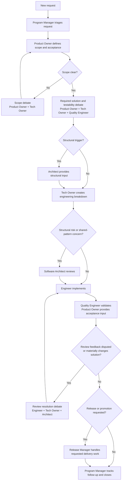

# Information Technology Core Team Operating Model

## Purpose

This document is the human-friendly overview for the AI team framework's default organizational operating model.

The detailed framework definitions live in the responsibility, caravan template,
domain knowledge, runtime, and validation artifacts in this repository. Their
serialized identifiers remain unchanged; see the [vocabulary](vocabulary.md).

This operating model remains the entrypoint for understanding the intent of the default team at a high level.

## Contents

- [Design principles](#design-principles)
- [Canonical artifacts](#canonical-artifacts)
- [Default team](#default-team)
- [Default operating pattern](#default-operating-pattern)
- [Operating flow](#operating-flow)
- [Debate model](#debate-model)
- [Governance summary](#governance-summary)
- [Future expansion](#future-expansion)

## Design Principles

- Keep the core team small and durable.
- Separate product ownership from technical implementation ownership.
- Involve quality early enough to shape testability, not just validate after the fact.
- Use debate as a decision mechanism when tradeoffs are real.
- Allow engineers and technical owners to challenge weak review feedback.
- Distribute documentation ownership across the roles that create and use it.
- Preserve future expansion into specialist lanes without forcing that complexity into the core model.

## Canonical Artifacts

The current canonical artifacts are:

- responsibility spec: [role-spec-format.md](../../resources/specifications/role-spec-format.md)
- core responsibility artifacts: [responsibilities/README.md](../../resources/core/responsibilities/README.md)
- caravan template spec: [team-blueprint-format.md](../../resources/specifications/team-blueprint-format.md)
- default caravan template: [information-technology-core-team.md](../../resources/core/caravan-templates/information-technology-core-team.md)
- domain-pack spec: [domain-pack-spec.md](../../resources/specifications/domain-pack-spec.md)
- example domain knowledge: [sample-product-domain-pack.md](../../examples/sample-organization/domain-knowledge/sample-product.md)
- logical model: [logical-artifact-overlay-model.md](../../resources/specifications/logical-artifact-overlay-model.md)
- runtime model: [runtime-capability-adapter-spec.md](../../resources/specifications/runtime-capability-adapter-spec.md)
- validation model: [framework-validation-spec.md](../../resources/specifications/framework-validation-spec.md)

## Default Team

The default organizational team shape is the [Information Technology Core Team](../../resources/core/caravan-templates/information-technology-core-team.md).

Its current core responsibilities are:

1. `program-manager`
2. `product-owner`
3. `tech-owner`
4. `engineer`
5. `quality-engineer`
6. `software-architect`
7. `release-manager`

Detailed responsibility definitions live in their artifacts, not in this operating model.

## Default Operating Pattern

At a high level, the default team follows this flow while independent ready work can continue during a role handoff or wait:

1. `program-manager` triages the request and identifies process obligations.
2. `product-owner` defines scope, user/business intent, UX expectations, and acceptance criteria.
3. `product-owner`, `tech-owner`, and `quality-engineer` run the mandatory `solution + testability debate`; involve `software-architect` when structural triggers apply.
4. `tech-owner` produces the technical breakdown and engineering-ready plan.
5. `software-architect` reviews before implementation when structural risk or shared-pattern concerns justify involvement.
6. `engineer` implements the solution.
7. `quality-engineer` validates the work and records readiness evidence.
8. `engineer`, `tech-owner`, and `software-architect` run the mandatory `review resolution debate` when review feedback is disputed or materially changes the solution.
9. `release-manager` handles MR, pipeline, merge, and release mechanics.
10. `program-manager` closes the loop, tracks outstanding obligations, and coordinates follow-up.

This flow is canonically represented in the caravan template rather than maintained here as the only source of truth.

### Operating Flow

The diagram summarizes the blueprint's default operating pattern. Conditional
paths are shown only where the blueprint names a trigger or a warranted stage.
The active workflow and the task determine which roles and stages are
activated for a particular run; this diagram does not promise that every role
participates in every task.

The release stage coordinates requested delivery work. The feature-delivery
workflow separately requires human approval for remote mutation,
release, deployment, and other listed actions; see the canonical
[workflow](../../resources/execution/workflows/information-technology-core-team-feature-delivery.json).

## Debate Model

Debate is an intentional part of the operating model. It exists to improve decisions, not to create ceremony.

### Mandatory Debates

- `solution + testability debate`
  - Participants: `product-owner`, `tech-owner`, `quality-engineer`; involve `software-architect` when cross-system change, architectural guardrail departure, structural risk, or material maintainability tradeoff applies
  - Purpose: align on product intent, technical feasibility, and testability before implementation begins, with structural guidance when triggered

- `review resolution debate`
  - Participants: `engineer`, `tech-owner`, `software-architect`
  - Purpose: resolve disputed review feedback and converge on a viable technical solution

### Triggered Debates

- `scope debate`
  - Participants: `product-owner`, `tech-owner`
  - Trigger: ambiguity or conflict between requested outcome and realistic implementation scope

- `risk debate`
  - Participants: `quality-engineer`, `tech-owner`, `software-architect`
  - Trigger: meaningful delivery, quality, structural, or operational risk

- `priority debate`
  - Participants: `program-manager`, `product-owner`, `tech-owner`
  - Trigger: sequencing conflict, competing work, or process-timing pressure

- `technical debt debate`
  - Participants: `engineer`, `tech-owner`, `product-owner`, `software-architect`
  - Trigger: proposed shortcut, deferred cleanup, or design compromise with future cost

Blocking rules, documentation ownership, and governance ownership are canonical in the responsibility artifacts and caravan template.

## Governance Summary

New dependencies, integrations, or external tools may introduce security or governance obligations.

At a high level:

1. `tech-owner` identifies the need.
2. `program-manager` owns routing, tracking, and follow-up of the required approval path.
3. The implementing role may continue only where safe and appropriate within that constraint.

## Future Expansion

The core team is intentionally designed to support optional specialist lanes later without changing the base structure.

Examples of future specialist lanes may include:

- `data-engineer`
- `business-intelligence-engineer`
- `security-engineer`
- `integration-architect`

These are expansion points, not current default roles. They should be introduced only when the operating model is ready to define their routing rules and handoff behavior clearly.

## Summary

This operating model is the human-readable overview for the framework's default organizational team.

The canonical detailed definitions live in the responsibility, caravan template,
domain knowledge, logical model, runtime, and validation artifacts.
